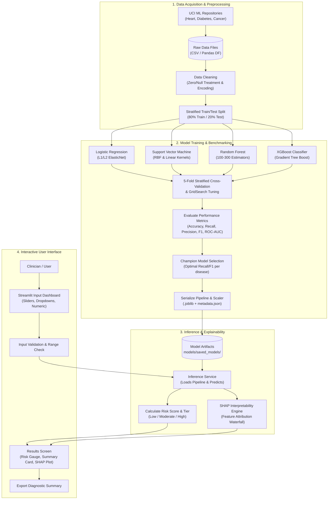

# System Architecture Document
## Multi-Disease Prediction System from Medical Data

---

### 1. Architectural Overview & Principles

The **Multi-Disease Prediction System** is designed following a **Layered, Modular, and Decoupled Architecture**. It separates data ingestion and preprocessing, model training and hyperparameter tuning, model persistence, explainability (XAI), and presentation/serving into independent, single-responsibility modules.

```
       +-------------------------------------------------------------+
       |               Presentation Layer (Streamlit UI)             |
       |  - Patient Clinical Input Form  - Risk Gauge & Alert Cards  |
       |  - Model Benchmark Explorer     - SHAP Feature Explanations |
       +------------------------------+------------------------------+
                                      |
                                      v
       +-------------------------------------------------------------+
       |               Inference & Explainability Engine             |
       |  - Request Validation (Pydantic / Clinical Rules)           |
       |  - Calibrated Probability Calculation                       |
       |  - SHAP Explainer (TreeExplainer / LinearExplainer)         |
       +------------------------------+------------------------------+
                                      |
                                      v
       +-------------------------------------------------------------+
       |                  Model Registry & Artifacts                 |
       |  - Pre-trained sklearn & XGBoost Pipelines (.joblib)        |
       |  - Model Metrics, Confusion Matrices & Benchmark Metadata   |
       +------------------------------+------------------------------+
                                      |
                                      v
       +-------------------------------------------------------------+
       |              Training & Hyperparameter Tuning Engine         |
       |  - Logistic Regression  |  Support Vector Machine (SVM)     |
       |  - Random Forest        |  Extreme Gradient Boosting (XGB)  |
       |  - Stratified 5-Fold CV |  GridSearchCV / Best Model Selector|
       +------------------------------+------------------------------+
                                      |
                                      v
       +-------------------------------------------------------------+
       |                 Data & Preprocessing Pipeline               |
       |  - Imputation (Median/KNN for zeroes/NaNs)                  |
       |  - Feature Scaling (StandardScaler)                         |
       |  - Stratified Train/Test Split (80/20)                      |
       +------------------------------+------------------------------+
                                      |
                                      v
       +-------------------------------------------------------------+
       |                 Storage / Data Sources Layer                |
       |  - Heart Disease (Cleveland UCI)                            |
       |  - Diabetes (Pima Indians UCI)                              |
       |  - Breast Cancer (Wisconsin Diagnostic UCI)                 |
       +-------------------------------------------------------------+
```

#### Core Design Principles:
1. **Strict Data Leakage Prevention**: All transformations (imputation, scaling) must be encapsulated within Scikit-Learn `Pipeline` instances and fitted strictly on training data folds.
2. **Modular Pluggability**: Adding a new disease dataset or a new algorithm requires adding a single pipeline script without refactoring existing disease modules.
3. **Reproducibility by Design**: Deterministic execution across all modeling steps by fixing pseudo-random number seeds (`random_state=42`).
4. **Clinical Safety & Guardrails**: Boundaries and sanity checks applied on inputs before reaching model inference, preventing out-of-distribution numerical crashes.
5. **Decoupled Inference**: The UI communicates strictly with the loaded pipeline object, abstracting internal model intricacies.

---

### 2. End-to-End System Workflow

The following flowchart illustrates the complete lifecycle from raw data acquisition to real-time clinical prediction and interpretability:



---

### 3. Subsystem Breakdown & Module Details

#### 3.1 Data Management Subsystem (`data/` & `src/preprocessing/`)
* **Data Sources**:
  * `heart.csv`: 303 rows, 13 features + 1 target
  * `diabetes.csv`: 768 rows, 8 features + 1 target
  * `breast_cancer.csv`: 569 rows, 30 features + 1 target
* **Specialized Preprocessing Logic**:
  * *Diabetes Zero-Replacement*: Replaces physiological zeros in `Glucose`, `BloodPressure`, `SkinThickness`, `Insulin`, and `BMI` with `np.nan`, followed by median imputation.
  * *Categorical Feature Encoding*: Maps categorical features (e.g. sex, chest pain type, resting ECG) into clean numerical codes or one-hot vectors.
  * *Feature Scaling*: Implements `StandardScaler` to normalize distributions for distance-sensitive models (SVM, Logistic Regression).

#### 3.2 Machine Learning Engine (`src/models/`)
Four distinct algorithms are trained and compared for each disease:
1. **Logistic Regression (`LogisticRegression`)**:
   * Baseline linear probabilistic model.
   * Scaled with L2 penalty, tuned solver (`lbfgs` / `saga`), and regularization parameter $C \in [0.01, 0.1, 1, 10]$.
2. **Support Vector Machine (`SVC`)**:
   * Non-linear decision hyperplane mapping using Radial Basis Function (RBF) and Linear kernels.
   * Parameter tuning for $C$, $\gamma$ (`scale` vs `auto`), and `probability=True` for Platt scaling probability estimation.
3. **Random Forest Classifier (`RandomForestClassifier`)**:
   * Ensemble of bagging decision trees with bootstrap aggregation.
   * Tuned parameters: `n_estimators` (100 to 300), `max_depth` (3 to 15), `min_samples_split` (2 to 10).
4. **XGBoost Classifier (`XGBClassifier`)**:
   * Gradient boosted decision trees optimized with regularization ($\alpha$, $\lambda$).
   * Tuned parameters: `learning_rate` (0.01 to 0.2), `max_depth` (3 to 7), `subsample` (0.8 to 1.0).

#### 3.3 Evaluation & Comparison Module (`src/evaluation/`)
* **Metrics Calculated**:
  $$\text{Accuracy} = \frac{TP + TN}{TP + TN + FP + FN}$$
  $$\text{Recall (Sensitivity)} = \frac{TP}{TP + FN} \quad \text{(Crucial for medical safety to prevent False Negatives)}$$
  $$\text{Precision} = \frac{TP}{TP + FP}$$
  $$\text{F1-Score} = 2 \times \frac{\text{Precision} \times \text{Recall}}{\text{Precision} + \text{Recall}}$$
  $$\text{ROC-AUC} = \text{Area under the Receiver Operating Characteristic Curve}$$
* **Outputs Generated**:
  * Comparative tabular metric rankings.
  * Confusion matrix heatmaps for each algorithm.
  * Combined ROC curves displaying all 4 models on a single figure for clear visual comparison.

#### 3.4 Explainability & Interpretability Subsystem (`src/explainability/`)
* Utilizes **SHAP (SHapley Additive exPlanations)** based on cooperative game theory:
  * **TreeExplainer**: Fast exact attribution computation for Random Forest and XGBoost.
  * **LinearExplainer / KernelExplainer**: Attribution computation for Logistic Regression and SVM.
* Delivers:
  1. **Global Importance**: Highlights the top risk factors across the entire patient population.
  2. **Local Patient Force/Waterfall Plot**: Demonstrates how an individual patient's specific lab values (e.g., Blood Pressure = 160 mm Hg) pushed their risk above the baseline threshold.

#### 3.5 User Presentation Subsystem (`app/`)
* Built with **Streamlit** for rapid, responsive, and reactive user experiences.
* **Layout Structure**:
  * **Sidebar**: Disease selection (`Heart Disease`, `Diabetes`, `Breast Cancer`), model selector (Champion vs Manual Algorithm Selection), and quick demo presets.
  * **Main Screen**:
    * Tab 1: **Patient Risk Assessment** (Dynamic input form organized by clinical categories, prediction trigger, visual risk meter, risk level badges, and SHAP attribution).
    * Tab 2: **Model Benchmarks & Metrics** (Interactive comparison tables, ROC curves, confusion matrices, and feature importance rankings).
    * Tab 3: **Dataset Explorer** (Descriptive statistics, distribution plots, and correlation heatmaps).

---

### 4. Technology Stack

| Component | Technology | Version | Purpose |
| :--- | :--- | :--- | :--- |
| **Language** | Python | 3.10+ | Core programming environment |
| **Data Manipulation** | Pandas, NumPy | 2.x, 1.26+ | Data frames, matrix operations, missing value handling |
| **Machine Learning** | Scikit-Learn | 1.4+ | ML models (SVM, LogReg, RF), pipelines, cross-validation, metrics |
| **Gradient Boosting** | XGBoost | 2.0+ | Extreme Gradient Boosted decision trees |
| **Model Explainability**| SHAP | 0.44+ | Unified model interpretability and Shapley value visualizations |
| **Visualization** | Matplotlib, Seaborn, Plotly | Latest | Statistical plots, confusion matrices, interactive ROC charts |
| **Artifact Persistence**| Joblib | 1.3+ | Serialization of trained pipeline objects and scalers |
| **Web Interface** | Streamlit | 1.32+ | Interactive healthcare decision-support web app |
| **Testing** | Pytest | 8.0+ | Automated unit tests for data cleaning and inference pipelines |

---

### 5. Repository & Directory Structure

```plaintext
disease-prediction/
│
├── data/                               # Data storage
│   ├── raw/                            # Original benchmark datasets from UCI
│   │   ├── heart.csv
│   │   ├── diabetes.csv
│   │   └── breast_cancer.csv
│   └── processed/                      # Cleaned, standardized train/test sets
│
├── models/                             # Serialized model artifacts
│   ├── saved_models/                   # Persisted .joblib model pipelines
│   │   ├── heart_champion_pipeline.joblib
│   │   ├── diabetes_champion_pipeline.joblib
│   │   ├── breast_cancer_champion_pipeline.joblib
│   │   └── ...                         # All individual algorithm checkpoints
│   └── metrics/                        # Stored benchmark comparison JSON/CSVs
│       ├── heart_metrics.csv
│       ├── diabetes_metrics.csv
│       └── breast_cancer_metrics.csv
│
├── src/                                # Core application source code
│   ├── __init__.py
│   ├── config.py                       # Configuration constants, paths, parameters
│   ├── data_loader.py                  # Ingestion and synthetic/sample generator
│   ├── preprocessing.py                # Cleaning, imputation, and feature pipelines
│   ├── train.py                        # Model training, hyperparameter tuning & benchmarking
│   ├── evaluate.py                     # Metric calculation and evaluation plots
│   ├── explainability.py               # SHAP explainers and feature importance tools
│   └── predictor.py                    # Unified inference service for single/batch prediction
│
├── app/                                # Streamlit Web Application
│   ├── main.py                         # Application entry point & router
│   ├── components/                     # Modular UI components
│   │   ├── input_forms.py              # Clinical input widgets for each disease
│   │   ├── visualizers.py              # Risk gauges, metrics tables, charts
│   │   └── report_generator.py         # Summary export helper
│   └── styles/
│       └── custom.css                  # Clean, modern medical UI theme
│
├── tests/                              # Unit & integration tests
│   ├── test_preprocessing.py
│   ├── test_training.py
│   └── test_predictor.py
│
├── notebooks/                          # Exploratory Data Analysis & experiments
│   └── eda_and_benchmarking.ipynb
│
├── architecture.md                     # System Architecture Document
├── prd.md                              # Product Requirements Document
├── plan.md                             # Step-by-Step Implementation Roadmap
├── requirements.txt                    # Project Python dependencies
├── Dockerfile                          # Containerization specification
└── README.md                           # Quickstart and project documentation
```

---

### 6. Security, Clinical Safety & Error Handling

1. **Input Boundary Enforcement**:
   * Inputs are bounded against established clinical thresholds (e.g. resting heart rate between $30 - 220\text{ bpm}$, serum glucose between $40 - 500\text{ mg/dL}$). Out-of-bounds values trigger clear UI guidance.
2. **Missing Feature Graceful Fallbacks**:
   * If non-essential features are omitted in batch runs, default median imputation values are applied without crashing the pipeline.
3. **Model Versioning & Integrity Check**:
   * All serialized artifacts store MD5 checksums and metadata (trained date, features list, algorithm name, Scikit-Learn version) to prevent mismatched pipeline deployments.
4. **Data Privacy**:
   * Operates completely in-memory without logging or storing personally identifiable health information (PHI) to disk or remote servers.
